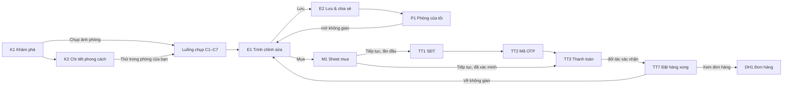
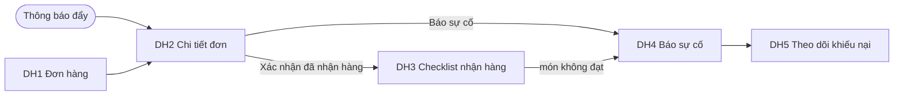
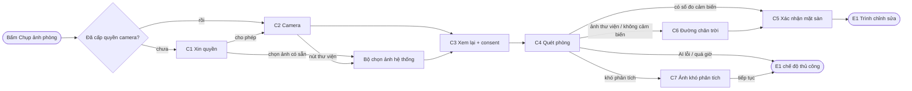

# YourSpace — Kế hoạch giao diện MVP (app iOS)

> Soạn 2026-10-03, cập nhật cùng ngày sau khi founder chốt thanh toán giữ tiền trong MVP.
> Sửa flow 2026-10-03 (founder duyệt): bỏ những bước lấy từ epic mà PRD §4.2 và flow HTML không có — bỏ C8 (chọn phong cách sau khi chụp), gộp TT3–TT6 thành một bước Thanh toán và bỏ trả góp, bỏ M2 "Tôi muốn tư vấn", bỏ mua thẳng từ K4. Flow lấy từ PRD §4.2 + flow HTML; epic chỉ là ràng buộc nội dung.
> Nguồn: flow ở `Product/PRD.md` §4.2 và `Product/prd/assets/hanh-trinh-yourspace.html`; user story ở `Product/prd/epics/`; bối cảnh ở `PRODUCT.md`; quy tắc thị giác ở `design-system/yourspace/MASTER.md`.
> Nền tảng: iOS trước (React Native + Expo Router, bên dưới là React Navigation), Android chỉnh sau.
> Prototype UI/UX (2026-10-03): `apps/mobile`, thuần giả lập — không backend, camera, AI hay thanh toán thật. Cách chạy ở `apps/mobile/README.md`.
> Mã màn trong file này là mã mới. Cột "Epic · mã cũ" trỏ về user story và mã màn đang dùng trong epic để tra tiêu chí nghiệm thu.

## 0. Phạm vi MVP

- **MVP = các epic P0 và P1 của PRD**, xoay quanh hành trình "Thử phòng rồi mua", cộng Khám phá phong cách, Lưu / Phòng của tôi, Xóa đồ cũ và quyền riêng tư.
- **"Mua" là thanh toán giữ tiền trong app** (founder chốt 2026-10-03): xác minh SĐT bằng OTP ở lần đầu, thanh toán một lần, hệ thống tách đơn theo nhà cung cấp, mua xong về đúng nơi xuất phát (E7-US4, US5, US6).
- **Đơn hàng thuộc MVP** (E8-US1 đến US5): tiền chỉ chuyển cho nhà cung cấp khi người mua xác nhận đã nhận hàng, nên không có màn xác nhận thì không đóng được vòng tiền.
- **Không dùng nữa:** link affiliate và "Mua cả bộ" bằng danh sách link (E7-US2, E7-US3 là biến thể M1).
- **Không có trong flow nên không làm:** trả góp; thu lead "Tôi muốn tư vấn" trong sheet Mua (hỏi chuyên gia thuộc nhánh Nhờ người duyệt); mua thẳng từ trang món (chỉ mua món đã thử trong không gian, hoặc từ Thiết kế có sẵn khi vào phạm vi).
- **Ngoài MVP:** đánh giá món, đổi chất liệu, Yêu thích, trung tâm thông báo trong app, nhờ duyệt qua link, đồng bộ (Giai đoạn 2); Thiết kế có sẵn, Nhà hàng xóm, chuyên gia (Giai đoạn 3). Điều hướng ở mục 2 đã chừa chỗ cho chúng.
- **Phụ thuộc ngoài thiết kế:** đối tác thanh toán giữ tiền, hợp đồng và SLA với nhà cung cấp, nhà cung cấp SMS cho OTP. Chưa chốt đối tác thì UI không hiện tên hay logo của họ (E7-US5 AC5). Xem mục 8.2.

## 1. Flow chính

Hành trình ưu tiên số một (PRD §4.2, "Thử phòng rồi mua"):



Sau khi mua (tab Tôi):



Luồng chụp chi tiết (một modal toàn màn, tự đóng khi vào Trình chỉnh sửa):



Không có bước chọn phong cách sau khi chụp (PRD §4.2: Hiểu phòng → Trình chỉnh sửa). Phong cách là tab trong khay của E1; vào từ K2 hoặc K4 thì khay mở sẵn phong cách đang xem.

## 2. Cấu trúc điều hướng (iOS)

Dùng Expo Router (file-based, bên dưới là React Navigation): một native stack gốc chứa tab bar và các màn toàn màn hình. Route có kiểu (typed routes); mỗi màn có đường dẫn nên deep link có sẵn.

```
RootStack (native stack)
├── Tabs (bottom tabs)
│   ├── Khám phá   → stack: K1 → K2 → K3 → K4
│   ├── Phòng      → stack: P1
│   └── Tôi        → stack: T1 → T2
│                          T1 → DH1 → DH2 → DH3 | DH4 → DH5
│      (Giai đoạn 2 thêm tab Yêu thích, thành 4 ô)
├── E1 Trình chỉnh sửa       push, toàn màn, ẩn tab bar
├── Capture (C1–C7)          fullScreenModal, stack riêng, nút Đóng ở mọi bước
├── Mua (modal dạng page sheet, stack riêng)
│   M1 → [TT1 → TT2] → TT3 Thanh toán → TT7
└── Sheets (formSheet, có detent)
    ├── E2                   lưu & chia sẻ
    └── K4                   chi tiết món khi mở từ khay của E1
Action sheet hệ thống: E3 (rời E1 khi chưa lưu), xác nhận xóa không gian, xác nhận đóng sheet Mua giữa chừng
```

| Thành phần | Kiểu iOS | Lý do |
|---|---|---|
| Khám phá, Phòng, Tôi | Tab bar, large title ở màn gốc | Ba khu vực cấp cao, dùng song song; mỗi tab giữ stack riêng |
| Thử phòng | **Không phải tab**; là nút chính của K1 và nút "+" trên thanh tiêu đề của P1 | Tab bar chỉ chứa khu vực, không chứa hành động (hướng dẫn iOS) |
| Luồng chụp C1–C7 | Modal toàn màn | Tác vụ khép kín, camera cần toàn màn; mở được từ K1, K2, K4, P1; đóng là về đúng nơi mở |
| Trình chỉnh sửa E1 | Push trên stack gốc, ẩn tab bar | Không gian làm việc chính, không phải tác vụ phụ nên không dùng modal |
| Mua và thanh toán (M1, TT1–TT3, TT7) | **Một modal dạng page sheet** có stack riêng (nhiều bước nên không dùng formSheet có detent) | Tác vụ khép kín mở ngay trên không gian (hoặc K4). Đóng sheet là về đúng nơi xuất phát, đáp ứng "mua xong về đúng chỗ" (E7-US6) mà không cần điều hướng riêng |
| Đơn hàng DH1–DH5 | Stack trong tab Tôi | Người dùng quay lại nhiều ngày sau; mở được từ thông báo đẩy |
| Lưu & chia sẻ E2 | Sheet có detent | Tác vụ ngắn; vuốt xuống để đóng |
| Rời E1, xóa không gian, đóng sheet Mua giữa chừng | Action sheet hệ thống | Xác nhận một lần, theo điều khiển gốc của iOS |

**Chuyển cảnh quan trọng**

- Xong C5 (hoặc C7 → tiếp tục, hoặc C3 → "Không gửi ảnh"): tạo không gian, đóng modal chụp và push E1. Bấm quay lại ở E1 về đúng màn đã mở luồng chụp, không về camera.
- TT7 "Về không gian": đóng cả sheet Mua; E1 hiện nhãn "Đã mua". TT7 "Xem đơn hàng": đóng sheet, chuyển sang tab Tôi và mở DH1. Không để các bước thanh toán lại trong lịch sử quay lại.
- Sheet Mua: vuốt xuống để đóng được ở M1. Từ khi đã nhập thông tin giao hàng thì vuốt xuống phải qua xác nhận; khi đang chờ đối tác xác nhận thanh toán (TT3) thì đóng sheet phải qua xác nhận và nói rõ đơn sẽ hiện trong Đơn hàng khi có kết quả. Nút "Đóng" luôn hiện.
- Trong E1, các cử chỉ trên canvas không bắt đầu từ dải 20 pt sát mép trái, để cử chỉ vuốt mép trái quay lại vẫn dùng được.
- Tab Tôi có badge khi có đơn đã giao chờ xác nhận; badge mất khi người dùng xác nhận hoặc báo sự cố.

**Deep link (MVP):** không gian đã lưu, phong cách, món, chi tiết đơn (DH2), khiếu nại (DH5). Thông báo đẩy về đơn hàng mở thẳng DH2 hoặc DH5. Giai đoạn 3 thêm link thiết kế (E2-US2 CC3).

### 2.1 Đối chiếu nhóm luật Navigation của ui-ux-pro-max

Tra ngày 2026-10-03: `--domain ux` có 6 luật Navigation (3 luật chỉ cho web: Smooth Scroll, Sticky Navigation, Breadcrumbs, không áp dụng); `--domain web` (giao diện app) có 3 luật; `--stack react-native` có 4 luật; danh sách 26 luật "Navigation Patterns" ở Quick Reference §9 của skill. Thêm luật Progress Indicators của nhóm Feedback vì có hai luồng nhiều bước.

| Luật | Nguồn | Kết quả | Kế hoạch đáp ứng thế nào |
|---|---|---|---|
| Back Behavior (Critical) / Back Button (High) / back-behavior | app-interface, ux, §9 | Đạt | Native stack `goBack`; mỗi tab giữ stack; E1 ghi trạng thái trước khi rời |
| Bottom Tabs: 3–5 ô / bottom-nav-limit | app-interface, §9 | Đạt | MVP 3 ô, Giai đoạn 2 có 4 ô |
| tab-bar-ios / bottom-nav-top-level | §9 | Đạt, **lệch E1-US4** | Tab chỉ chứa khu vực. E1-US4 đặt "Thử phòng" làm ô giữa của tab bar 5 ô; kế hoạch này bỏ ô đó (mục 8, Q2) |
| Active State / nav-state-active / nav-label-icon | ux, §9 | Đạt | Mỗi ô có icon + chữ; ô đang chọn đổi icon sang dạng Fill và đổi màu, không chỉ đổi màu |
| tab-badge | §9 | Đạt | Badge trên tab Tôi chỉ khi có đơn chờ xác nhận; mất khi đã xử lý |
| Modal Escape (High) / modal-escape | app-interface, §9 | Đạt | Mọi sheet có "Đóng" và vuốt xuống; luồng chụp có "Đóng" ở mọi bước |
| sheet-dismiss-confirm (Forms) | §8 của skill | Đạt | Sheet Mua hỏi trước khi đóng khi đã nhập thông tin giao hàng hoặc đang chờ thanh toán |
| modal-vs-navigation | §9 | Đạt, có giải thích | Modal và sheet chỉ cho tác vụ khép kín (chụp, mua, lưu). E1 là màn đích nên dùng push |
| Deep Linking / deep-linking / Use deep linking | ux, §9, react-native | Đạt | `linking` cho không gian, phong cách, món, đơn, khiếu nại |
| state-preservation | §9 | Đạt | K3 giữ bộ lọc và vị trí cuộn (E1-US6 AC5); mỗi tab giữ stack; sheet Mua giữ lựa chọn khi app bị đóng ở nền |
| back-stack-integrity | §9 | Đạt | Vào E1 thì đóng modal chụp; xong thanh toán thì đóng cả sheet, không quay lại được bước đã trả tiền |
| gesture-nav-support | §9 | Đạt | Giữ cử chỉ vuốt mép trái; canvas chừa dải mép |
| persistent-nav | §9 | Lệch có chủ đích | E1 ẩn tab bar để canvas đủ chỗ; luôn có nút quay lại và Lưu |
| avoid-mixed-patterns / nav-hierarchy | §9 | Đạt | Chỉ tab + stack + sheet, không có drawer |
| overflow-menu | §9 | Đạt | Thao tác phụ của E1 nằm trong menu "…" |
| destructive-nav-separation | §9 | Đạt | Xóa không gian, xóa dữ liệu có xác nhận và tách khỏi thao tác thường |
| empty-nav-state | §9 | Đạt | Tab Phòng trống và Đơn hàng trống đều giải thích và có một hành động gợi ý |
| search-accessible | §9 | Chưa áp dụng | Tìm kiếm chưa có story (E01 để ngoài phạm vi) |
| Progress Indicators (multi-step) | ux | Đạt ở thanh toán, lệch ở luồng chụp | Lần mua đầu có 2 bước (Xác minh SĐT · Thanh toán) kèm chỉ báo bước; đã xác minh thì chỉ còn một bước, không hiện chỉ báo. Luồng chụp không dùng bộ đếm bước theo quyết định của founder; mỗi bước có tiêu đề nói rõ đang làm gì |
| Use React Navigation / Type navigation params / Handle back button | react-native | Đạt | Như đầu mục 2. Nút back phần cứng là việc của Android (giai đoạn sau) |

## 3. Thứ tự build

Mỗi bước kết thúc bằng một luồng chạy được trên máy thật.

| Bước | Nội dung | Màn | Vì sao ở vị trí này |
|---|---|---|---|
| 0 | Khung điều hướng (mục 2), token và component của MASTER.md: nút, thẻ, ô nhập, sheet | — | Mọi màn dùng chung |
| 1 | **Vòng lõi tới sheet mua:** chụp → quét → xác nhận sàn → đặt món, kéo, xoay, chỉnh tay, hoàn tác → dự toán → M1 chọn món và thấy tổng | K1 (tối thiểu), C1–C5, E1 (thêm đồ), M1 | Rủi ro số một là độ thật của ảnh ghép; xong bước này đã thử được với người dùng, trước khi có đối tác thanh toán |
| 2 | **Đường lui của vòng lõi:** ảnh thư viện, ảnh khó, AI tạm ngưng, máy yếu, từ chối quyền camera, mất mạng | C6, C7, trạng thái thủ công và 2D của E1 | Người thử không được kẹt khi AI sai |
| 3 | **Lưu và quay lại** | E2, E3, P1, khối "Tiếp tục" ở K1 | Thanh toán cần không gian đã lưu: về không gian với nhãn "Đã mua", khôi phục khi app bị đóng giữa lúc trả tiền |
| 4 | **Thanh toán giữ tiền** | TT1–TT3, TT7, nhãn "Đã mua" ở E1 | Đóng vòng mua. Dựng UI với đối tác giả lập, không tên, không logo; tích hợp thật khi chốt đối tác (mục 8.2, Q10) |
| 5 | **Đơn hàng và thông báo đẩy** | T1, DH1–DH5 | Không có xác nhận nhận hàng thì nhà cung cấp không nhận được tiền; chưa xong bước này thì chưa ra mắt được |
| 6 | **Khám phá phong cách** | K1 đầy đủ, K2, K3, K4 | P0 nhưng không chặn vòng tiền; làm song song với bước 4–5 nếu có người |
| 7 | **Xóa đồ cũ** | Trạng thái công cụ Xóa của E1 | P1, đứng thứ ba trong thang cắt scope; tốn chi phí AI |
| 8 | **Quyền riêng tư** | T2 | Cần trước khi phát hành (NĐ13) |

## 4. Trạng thái dùng chung

Định nghĩa một lần, các màn bên dưới chỉ trỏ tới.

- **G1 Mất mạng:** băng thông báo có icon + chữ và nút "Thử lại". Dữ liệu đã có trên máy vẫn hiện; giá hiện kèm ghi chú "giá lần cập nhật gần nhất". Không báo thành công khi máy chủ chưa xác nhận. Mọi bước thanh toán cần mạng.
- **G2 AI tạm ngưng:** khi không lấy được depth (quá ~20 giây, rate limit, vượt ngân sách, nhà cung cấp AI lỗi). Không chặn: E1 vào chế độ thủ công, nói ngắn rằng AI đang tạm ngưng và bạn tự đặt đồ được, không có câu đổ lỗi cho người dùng. AI hồi lại giữa phiên thì không tự căn lại các món đã đặt.
- **G3 Máy yếu:** không render được 3D thì xem 2D; khay, dự toán và nút Mua vẫn dùng được. Cách hiển thị 2D cụ thể chưa chốt (E4-US6 CC3).
- **G4 Đang tải:** dưới 1 giây thì không hiện gì; lâu hơn thì khung xương (skeleton) đúng kích thước nội dung; tác vụ AI và thanh toán có chữ nói đang làm gì.
- **G5 Chống bấm hai lần:** nút gửi, thanh toán, xác nhận nhận hàng giữ nguyên kích thước, hiện trạng thái đang xử lý và không nhận bấm lần hai; máy chủ chỉ ghi nhận một lần.
- **Chữ bắt buộc** (nguyên văn theo `PRODUCT.md`): consent ở C3; chip AI ở E1; câu giữ tiền "YourSpace không cầm tiền của bạn. Khoản thanh toán được giữ tại đối tác thanh toán được cấp phép đến khi bạn nhận hàng." ở M1, TT3, DH2, luôn kèm icon. Không câu nào nói hay ngụ ý YourSpace giữ tiền; không hiện phí hay hoa hồng của YourSpace.

## 5. Màn hình MVP

| ID | Màn | Kiểu | Epic · mã cũ | Bước |
|---|---|---|---|---|
| K1 | Khám phá (màn mở đầu) | Gốc tab Khám phá | E1-US1, US2, US5 · Main, 01-1, 02-1 | 1, 3, 6 |
| K2 | Chi tiết phong cách | Push | E1-US5 · 02-2 | 6 |
| K3 | Món theo phong cách | Push | E1-US6 · 02-3 | 6 |
| K4 | Chi tiết món | Push (từ K2, K3) / sheet (từ khay E1) | E1-US7 · 02-4 | 6 |
| C1 | Xin quyền camera | Luồng chụp | E1-US3 · 01-3 | 1 |
| C2 | Camera | Luồng chụp | E3-US1, US2 · 03-1, 03-2 | 1 |
| C3 | Xem lại & consent | Luồng chụp | E3-US3 · 03-3 | 1 |
| C4 | Quét phòng | Luồng chụp | E3-US4 · 03-4 | 1 |
| C5 | Xác nhận mặt sàn | Luồng chụp | E3-US5 · 03-5 | 1 |
| C6 | Đường chân trời | Luồng chụp | E3-US5 AC3 · 03-6 | 2 |
| C7 | Ảnh khó phân tích | Luồng chụp | E3-US6 · 03-7 | 2 |
| E1 | Trình chỉnh sửa | Push toàn màn | E04, E05, E7-US6 AC4 · 05-1…05-6, 05-8, 04-1…04-4 | 1, 2, 4, 7 |
| E2 | Lưu & chia sẻ | Sheet | E6-US1, US2 · 05-7 | 3 |
| E3 | Rời trình chỉnh sửa khi chưa lưu | Action sheet | E1-US4 CC1 | 3 |
| M1 | Sheet mua | Sheet Mua | E7-US1 · 06-1 | 1 |
| TT1 | Số điện thoại | Sheet Mua | E7-US4 · 07-1 | 4 |
| TT2 | Mã OTP | Sheet Mua | E7-US4 · 07-2 | 4 |
| TT3 | Thanh toán | Sheet Mua | E7-US5 · 07-3…07-6 gộp | 4 |
| TT7 | Đặt hàng xong | Sheet Mua | E7-US6 · 07-7 | 4 |
| P1 | Phòng của tôi | Gốc tab Phòng | E6-US3 · 03-0 | 3 |
| T1 | Tôi | Gốc tab Tôi | E6-US7, E8-US1 · 12-1 | 5 |
| T2 | Quyền riêng tư & dữ liệu | Push | E6-US7 · 12-2 | 8 |
| DH1 | Đơn hàng | Push từ T1 | E8-US1 · 08-1 | 5 |
| DH2 | Chi tiết đơn | Push | E8-US2 · 08-2 | 5 |
| DH3 | Xác nhận đã nhận hàng | Push | E8-US3 · 08-3 | 5 |
| DH4 | Báo sự cố | Push | E8-US4 · 08-4 | 5 |
| DH5 | Theo dõi khiếu nại | Push | E8-US5 · 08-5 | 5 |

Bỏ so với danh sách màn trong epic: màn chọn nguồn ảnh 03-1 gộp vào C1 và C2 (nút thư viện trong camera, nút "Chọn ảnh có sẵn" ở C1); trang phong cách 02-1 gộp vào K1 vì MVP chỉ có 2–3 phong cách; giỏ hàng 06-2 không có trong MVP vì mua đi từ một không gian. Xem mục 8, Q5.

Bỏ vì PRD §4.2 và flow HTML không có (founder duyệt 2026-10-03): chọn phong cách sau khi chụp 05-0 (C8 cũ), các màn phương thức 07-4, trả góp 07-5, VietQR 07-6 (gộp vào TT3), "Tôi muốn tư vấn" (M2 cũ). Mã C8, M2, TT4–TT6 không dùng lại.

### K1 — Khám phá (màn mở đầu)

- **Mục đích:** bắt đầu ngay, không đăng ký: chụp phòng mình, xem phong cách, hoặc mở lại không gian đang dở.
- **Dữ liệu:** 2–3 phong cách (tên, một câu mô tả, ảnh); không gian lưu gần nhất nếu có (tên, số món, thời điểm lưu, ảnh thu nhỏ).
- **Hành động chính:** "Chụp ảnh phòng" → luồng chụp.
- **Hành động phụ:** thẻ phong cách → K2; khối "Tiếp tục" → "Mở" → E1; "Xem tất cả" → tab Phòng.
- **Loading:** khung xương cho thẻ phong cách; khối "Tiếp tục" đọc từ máy nên hiện ngay.
- **Empty:** chưa có không gian lưu thì không hiện khối "Tiếp tục", không hiện màn trống.
- **Error:** G1: vẫn hiện nút chụp và thẻ phong cách với tên, mô tả, ảnh thay bằng nền `muted`; không gian lưu bị hỏng thì báo không mở được và cho xóa khỏi danh sách. AI tạm ngưng không chặn màn này.
- **Không có:** form đăng ký, ô SĐT, xin quyền (E1-US1 AC2–AC3).

### K2 — Chi tiết phong cách

- **Mục đích:** giúp người dùng gọi tên gu và thấy gu đó bằng đồ thật.
- **Dữ liệu:** tên; đặc trưng (màu sắc, chất liệu, cảm xúc); món tiêu biểu (ảnh, tên, giá `12.400.000 ₫`).
- **Hành động chính:** "Thử trong phòng của bạn" → luồng chụp; phong cách này là tab mở sẵn của khay trong E1.
- **Hành động phụ:** "Xem tất cả món" → K3; chạm món → K4. Giai đoạn 3 thêm lối vào Thiết kế có sẵn.
- **Loading:** khung xương cho ảnh và lưới món.
- **Empty:** phong cách tạm chưa có món hiển thị được → vẫn hiện đặc trưng; phần món là màn trống gợi ý xem phong cách khác.
- **Error:** G1: hiện phần chữ có sẵn, báo mất mạng ở phần ảnh, có "Thử lại".

### K3 — Món theo phong cách

- **Mục đích:** duyệt món của một phong cách.
- **Dữ liệu:** món (ảnh, tên, giá, nhà cung cấp, kích thước `101 × 119 × 117 cm`); chip lọc loại đồ và chất liệu.
- **Hành động chính:** chạm món → K4 (màn danh sách, không có nút nền `accent`).
- **Hành động phụ:** bật / tắt chip lọc; chip đang bật có dấu chọn, không chỉ đổi màu.
- **Loading:** khung xương lưới.
- **Empty:** bộ lọc không ra món nào → "Không có món phù hợp" + nút "Bỏ lọc".
- **Error:** G1: giữ danh sách đã tải, ảnh chưa tải hiện nền `muted`, có "Thử lại". Món thiếu kích thước hoặc giá không được hiện (kiểm lúc build).
- **Quay lại:** giữ bộ lọc và vị trí cuộn.

### K4 — Chi tiết món

- **Mục đích:** xem kỹ một món trước khi thử trong phòng.
- **Dữ liệu:** mô hình 3D chỉ xoay quanh trục Y; tên, giá, nhà cung cấp, chất liệu, kích thước thật.
- **Hành động chính:** "Thử trong phòng của bạn": nếu đang có không gian mở thì đưa món vào khay của không gian đó; nếu chưa thì mở luồng chụp và món chờ sẵn trong khay.
- **Hành động phụ:** khi mở dạng sheet từ khay E1 thì có "Đóng". Không có "Mua": theo PRD §4.2 chỉ mua món đã thử trong phòng.
- **Loading:** khối giữ chỗ đúng kích thước thật trong lúc tải mô hình.
- **Empty:** không áp dụng.
- **Error:** tệp 3D lỗi → khối giữ chỗ + "Thử lại"; máy yếu (G3) → ảnh 2D, ghi rõ đang xem 2D; G1 → giữ chữ và giá, báo lỗi ở khung 3D.

### C1 — Xin quyền camera

- **Mục đích:** giải thích vì sao cần camera trước khi hệ điều hành hỏi; chỉ hiện ở lần bấm chụp đầu tiên.
- **Dữ liệu:** một câu: app cần camera để chụp phòng của bạn. Không nhắc tới việc gửi ảnh (consent nằm ở C3).
- **Hành động chính:** "Cho phép dùng camera" → hộp thoại quyền của iOS → C2.
- **Hành động phụ:** "Chọn ảnh có sẵn" → bộ chọn ảnh hệ thống → C3; "Đóng".
- **Loading / Empty:** không áp dụng.
- **Error:** từ chối quyền → ở lại C1, hướng dẫn mở lại trong Cài đặt, nút chính đổi thành "Mở Cài đặt", vẫn giữ "Chọn ảnh có sẵn"; không tự hỏi lại.

### C2 — Camera

- **Mục đích:** chụp một ảnh phòng thấy rõ sàn, máy cầm thẳng.
- **Dữ liệu:** khung ngắm; thước cân bằng từ cảm biến; gợi ý "Thấy rõ sàn nhà", khi chưa thấy sàn thì gợi ý lùi lại. Màn luôn tối, chữ trắng trên lớp phủ tối.
- **Hành động chính:** nút chụp. Tư thế máy lưu kèm ảnh là tư thế lúc ngắm (~600 ms trước khi bấm).
- **Hành động phụ:** ô thư viện → bộ chọn ảnh hệ thống; "Đóng".
- **Loading:** camera đang mở → nền tối + chữ "Đang mở camera".
- **Empty:** thư viện không có ảnh → gợi ý chụp ảnh mới.
- **Error:** không có cảm biến hoặc số đo vô lý → ẩn thước, vẫn cho chụp, ảnh đi qua C6; camera bị app khác chiếm hoặc lỗi → báo bằng icon + chữ, cho thử lại hoặc chọn ảnh có sẵn; tệp không đọc được → báo lỗi, cho chọn lại, không gửi gì.

### C3 — Xem lại & consent

- **Mục đích:** người dùng thấy ảnh sẽ dùng và đồng ý gửi ảnh trước lần gửi đầu tiên.
- **Dữ liệu:** ảnh vừa chụp hoặc chọn; ở lần gửi đầu, đúng câu "Ảnh được gửi lên hệ thống để xử lý và xóa ngay sau đó."
- **Hành động chính:** "Đồng ý và tiếp tục" (lần đầu) / "Dùng ảnh này" (các lần sau) → ảnh thu nhỏ trên máy về cạnh dài ~1600 px → C4. Chưa bấm thì không có dữ liệu ảnh nào rời máy.
- **Hành động phụ:** "Chụp lại" → C2 hoặc bộ chọn ảnh, không mất quyền camera; "Không gửi ảnh, tự đặt đồ" → E1 chế độ thủ công, công cụ Xóa tắt (đề xuất E3-US3 CC1, chờ founder, mục 8 Q7).
- **Loading / Empty:** không áp dụng.
- **Error:** G1 khi bấm tiếp tục → giữ ảnh trên máy, báo mất mạng, cho thử lại, không bắt chụp lại.

### C4 — Quét phòng

- **Mục đích:** lấy depth một lần cho ảnh và cho người dùng biết app đang làm gì.
- **Dữ liệu:** ảnh với vạch quét chạy một lượt; chữ mô tả việc đang làm.
- **Hành động chính:** không có; tự chuyển bước khi xong (mục tiêu ≤ 5 giây).
- **Hành động phụ:** "Hủy" → về C3.
- **Loading:** chính màn này là trạng thái chờ.
- **Empty:** không áp dụng.
- **Error:** quá ~20 giây, rate limit, vượt ngân sách hoặc nhà cung cấp AI lỗi → G2, vào E1 thủ công; G1 → giữ ảnh, cho thử lại (cùng hash, không tính phí hai lần); độ tin cậy thấp hoặc không tìm được mặt sàn → C7.

### C5 — Xác nhận mặt sàn

- **Mục đích:** để tỷ lệ đồ đúng, người dùng xác nhận vùng sàn và chiều cao máy app đang giả định.
- **Dữ liệu:** ảnh phủ vùng sàn; chiều cao máy (mặc định ~1,4 m).
- **Hành động chính:** "Đúng rồi" → E1.
- **Hành động phụ:** nút −/+ chỉnh chiều cao máy (mặc định là giá trị app đề xuất); "Không phải sàn nhà" (dạng link) → C7. Không có "Bỏ qua": cho cùng kết quả với "Đúng rồi" (critique 2026-10-03).
- **Loading / Empty:** không áp dụng.
- **Error:** không có sàn → C7.
- **Ghi chú thiết kế:** "chiều cao máy" là khái niệm kỹ thuật; nên diễn đạt bằng hình (người cầm máy, mốc 1,4 m) và thử với người dùng. Từ E1 quay lại được C5 mà không phải chụp lại (E3-US5 CC3).

### C6 — Đường chân trời

- **Mục đích:** với ảnh thư viện hoặc không có cảm biến, người dùng kéo một đường ngang về tầm mắt để app suy ra độ nghiêng máy.
- **Dữ liệu:** ảnh + một đường ngang kéo được, có chữ hướng dẫn.
- **Hành động chính:** "Xong" → C5.
- **Hành động phụ:** "Quay lại".
- **Error:** kéo ra ngoài khung hoặc tới vị trí vô lý → giới hạn ở mép khung và nhắc kéo về tầm mắt.

### C7 — Ảnh khó phân tích

- **Mục đích:** không chặn người dùng khi ảnh khó; cho lựa chọn đi tiếp hoặc chụp lại.
- **Dữ liệu:** lý do ngắn; mẹo chụp: thẳng, đủ sáng, thấy rõ sàn.
- **Hành động chính:** "Tiếp tục với ảnh này" → E1 chế độ thủ công.
- **Hành động phụ:** "Chụp lại" → C2.
- **Error:** đã chụp lại mà vẫn khó → không hiện C7 lần nữa trong phiên; vào thẳng E1 thủ công, giữ nút chụp lại trong E1.
- Ngưỡng "khó phân tích" khởi điểm: độ tin cậy depth < 0,4 trên > 50% diện tích ảnh; chốt lại sau spike.

### E1 — Trình chỉnh sửa

- **Mục đích:** biến ảnh phòng thật thành căn phòng người dùng muốn và luôn thấy tổng tiền.
- **Dữ liệu:** ảnh phòng (kèm lớp lấp của vùng đã xóa); các món đã đặt (vị trí, góc quay quanh trục Y, tỷ lệ, đã mua hay chưa); khay (tab phong cách, chip loại đồ, món: ảnh, tên, giá); dự toán (tổng, số món); trạng thái AI; lịch sử hoàn tác ≥ 10 bước.
- **Vùng điều khiển:** thanh trên (quay lại, Hoàn tác / Làm lại, Lưu, menu "…"); canvas toàn màn; công tắc công cụ Thêm · Xóa; khay dạng bảng kéo được (thu gọn / mở); thanh dự toán ở đáy.
- **Hành động chính:** "Mua" trên thanh dự toán → sheet Mua (M1). Không gian chưa có món thì nút mờ, không bấm được.
- **Hành động phụ:** **chạm một món trong khay là món vào phòng** (kiểu IKEA Kreativ, founder yêu cầu 2026-10-03): AI chọn chỗ trống, lưng áp sát chân tường, tránh món đã đặt và đồ thật đang đứng trên sàn (đồ đã xóa thì không tính); dọc tường hết chỗ thì lùi dần ra phía trước. Món đáp xuống sàn rồi được chọn sẵn; chip "Đã đặt … sát tường · kéo để dời" + Hoàn tác. **Kéo món:** món luôn đứng trên sàn, không đẩy xuyên tường được; tới gần tường (≤ 18 pt) thì hít vào, rung nhẹ một lần và hiện vạch sáng ở chân tường sau lưng món; đang mở panel món thì không kéo món xuống dưới panel. Đổi món / Nhân bản giữ món sát tường nếu món gốc đang sát tường. Món từ "Thử trong phòng của bạn" (K4) chỉ được gợi ý: sáng ở hàng món + chip có nút "Đặt vào phòng". Bỏ bước "cầm món rồi chạm sàn". Chân tường lấy từ bước hiểu phòng (C5 vẽ vùng sàn theo chân tường); không có (chế độ tự đặt) thì là đường sàn ngang. Hạn chế bản thử: món là ảnh phẳng nên chưa xoay theo hướng tường xiên, và chưa che khuất theo độ sâu với đồ thật trong ảnh. Chạm món đã đặt để chọn → **thanh tác vụ nổi trên món** (founder yêu cầu 2026-10-03, kiểu IKEA Kreativ): **Mua** (mở M1 với riêng món này được chọn), **Lật** (xoay 180° quanh trục Y; bản thử dùng ảnh phẳng nên chưa xoay từng góc), **Đổi món** (mở khay đúng loại, ở phong cách còn món khác để đổi — ưu tiên phong cách của món; chọn món mới thay vào đúng chỗ), **Hợp với** (mở khay cùng phong cách, chip trên ảnh nói rõ đang xem món hợp với món nào), **Nhân bản**, **Bỏ** (có Hoàn tác). Món đang chọn hiện **số đo thật trên ảnh** (rộng ở chân, cao ở cạnh) và khay đáy có hàng **"Đổi với"** (món cùng loại, chạm là thay tại chỗ) — founder duyệt 2026-10-03, theo IKEA Kreativ. Kéo để dời. **Xoay món 3D** bằng thước xoay ở mép trái ảnh hoặc vặn hai ngón (kiểu IKEA, founder yêu cầu 2026-10-04): 0° = song song với tường, hít về 0°/±45°/±90°…, xoay tại chỗ, sát tường thì tự lùi ra; món ảnh phẳng chỉ có Lật. **Không phóng to / thu nhỏ món** (founder quyết 2026-10-04: phóng to dễ khiến người dùng lầm tưởng món vừa không gian) — bỏ chụm và bỏ Tỷ lệ, món luôn đúng kích thước thật; lệch E4-US4 "chỉnh kích thước". Hoàn tác / Làm lại; Lưu → E2; menu "…": chỉnh lại mặt sàn (C5), chụp lại.
- **Trạng thái:**
  - *Trống:* thanh dự toán `0 ₫ · 0 món`, nút Mua mờ; chip gợi ý trên ảnh "Chạm một món ở khay bên dưới, rồi chạm lên sàn để đặt" (polish 2026-10-03: gợi ý bước tiếp theo chuyển từ khay lên ảnh, cùng chỗ với gợi ý của Xóa đồ cũ, để khay thu gọn giữ một chiều cao).
  - *Vừa đặt món:* chip AI đúng câu "Đã tự căn theo mặt sàn · kéo để chỉnh". Chạm lên tường → món bám xuống sàn gần nhất, chip nói đã dời xuống sàn.
  - *Món đang chọn:* hiện tên, giá và các tay cầm; mỗi tay cầm ≥ 44 pt. Chỉnh kích thước khác xa gợi ý của AI vẫn giữ theo người dùng.
  - *Đã mua một phần (sau TT7):* món đã mua mang nhãn "Đã mua"; dự toán chỉ tính món chưa mua; không gian tự lưu với trạng thái này.
  - *Thủ công (G2, C7):* nói ngắn AI đang tạm ngưng; món vẫn bám sàn và có bóng; mọi thao tác tay vẫn chạy.
  - *Xem 2D (G3):* thấy được món đã chọn và tổng tiền; Mua vẫn dùng được.
  - *Công cụ Xóa (bước 7) — theo màn Erase của IKEA Kreativ, founder yêu cầu 2026-10-03:* vào công cụ là AI tìm đồ trong ảnh (chip "AI đang tìm đồ cũ trong ảnh", một lần mỗi ảnh); xong thì **mọi món AI nhận ra có viền bám sát dáng** — đồ lớn lẫn đồ nhỏ (đèn trần, ổ điện) — ảnh không tối đi, không nhãn; gợi ý "Chạm vào món có viền để xóa". **Chạm vào món nào là xóa món đó**, không hỏi lại vì hoàn tác được: chip "Đã xóa Tivi · hoàn tác nếu chưa ưng" + nút Hoàn tác, hoàn tác thì viền hiện lại. Đầu khay có **Xóa hết** (Hide All) và **Hiện lại hết** (Show All), mỗi nút một bước hoàn tác, cùng nút mắt giữ để xem ảnh gốc. Đang xóa → viền mờ, "Đang xóa" giữa món, vẫn chạm xóa món khác được, không khóa việc khác. Chạm ra ngoài các viền → nhắc "Chạm vào món có viền để xóa". Ảnh AI không nhận ra món nào (hoặc đã xóa hết) → chạm vào món đồ cũ thì chọn theo điểm chạm rồi xóa luôn. Chạm vào món mới đặt ở chế độ Xóa không xóa món đó. Thanh dự toán giữ nút Mua (Q8 bỏ). Lệch E5-US2 AC2 (chọn nhiều rồi xóa một lượt): nay mỗi món một lượt, "Xóa hết" là một lượt.
- **Loading:** mở không gian đã lưu → hiện ảnh trước, rồi các món; mô hình chưa tải → khối giữ chỗ đúng kích thước, dự toán vẫn tính.
- **Empty:** như trạng thái *Trống*.
- **Error:** mô hình 3D lỗi → khối giữ chỗ + thử tải lại; G1 → đặt, kéo, xoay được với món đã tải, món chưa tải chờ mạng, công cụ Xóa báo cần mạng; xóa đồ cũ lỗi hoặc quá giờ → ảnh không đổi, báo bằng icon + chữ, cho thử lại; từ chối gửi ảnh hoặc AI tạm ngưng → công cụ Xóa tắt kèm lý do; hết lịch sử hoàn tác → nút Hoàn tác mờ, có nhãn chữ.
- **Rời màn:** có thay đổi chưa lưu → E3.

### E2 — Lưu & chia sẻ

- **Mục đích:** giữ không gian để quay lại sau, hoặc gửi ảnh cho người khác.
- **Dữ liệu:** ảnh thu nhỏ của không gian; tên (đổi được); số món, tổng tiền.
- **Hành động chính:** "Lưu vào Phòng của tôi" (lưu trên máy, không cần đăng nhập) → đóng sheet, thông báo ngắn "Đã lưu vào Phòng của tôi".
- **Hành động phụ:** "Chia sẻ ảnh" → xuất ảnh đúng như trên canvas qua bảng chia sẻ của iOS. Giai đoạn 2 thêm "Nhờ người duyệt", Giai đoạn 3 thêm "Đăng lên Nhà hàng xóm".
- **Loading:** lưu trên máy nên tức thời; xuất ảnh > 1 giây thì nút hiện trạng thái đang xử lý.
- **Empty:** lưu được cả khi chưa có món.
- **Error:** bộ nhớ không đủ → báo lý do bằng icon + chữ, giữ sheet và không gian để người dùng giải phóng bộ nhớ rồi lưu lại. Mất mạng không ảnh hưởng.

### E3 — Rời trình chỉnh sửa khi chưa lưu

- **Mục đích:** không mất công sức người dùng một cách âm thầm.
- **Dữ liệu:** một câu: không gian có thay đổi chưa lưu.
- **Hành động:** "Lưu không gian" · "Bỏ thay đổi" (kiểu phá hủy) · "Ở lại" (hủy).

### M1 — Sheet mua

- **Mục đích:** chọn mua lẻ hoặc cả bộ, thấy tổng tiền theo nhà cung cấp trước khi thanh toán.
- **Dữ liệu:** các món trong không gian, nhóm theo nhà cung cấp, mặc định chọn hết; mỗi món: ảnh, tên, giá hiện tại; mỗi nhóm: tạm tính và ngày giao dự kiến; tổng các món đang chọn; câu giữ tiền kèm icon; dòng "Lần đầu mua: xác minh SĐT bằng mã OTP". Món đã mua mang nhãn "Đã mua" và không chọn sẵn.
- **Hành động chính:** "Tiếp tục · {tổng}" → TT1 nếu chưa xác minh SĐT, TT3 nếu đã xác minh.
- **Hành động phụ:** chọn / bỏ chọn từng món (tổng cập nhật ngay); "Đóng".
- **Loading:** giá cập nhật trong nền; chưa có giá mới thì hiện giá lần trước kèm ghi chú và "Tiếp tục" chờ giá mới.
- **Empty:** bỏ chọn hết → nút chính mờ kèm chữ "Chọn ít nhất một món".
- **Error:** G1 → giá lần cập nhật gần nhất kèm ghi chú, "Tiếp tục" báo cần mạng; món ngừng bán → nhãn "Ngừng bán", không chọn được, không tính vào tổng.

### TT1 — Số điện thoại

- **Mục đích:** xác minh người mua ở lần mua đầu. Đã xác minh khi đặt lịch chuyên gia hoặc đăng thiết kế thì bỏ qua.
- **Dữ liệu:** một ô SĐT; câu lý do: SĐT dùng để giao hàng và để đối tác thanh toán giữ khoản tiền đến khi bạn nhận hàng. Chỉ báo bước 1/2.
- **Hành động chính:** "Gửi mã".
- **Hành động phụ:** "Quay lại" → M1; "Đóng".
- **Không có:** tạo tài khoản, mật khẩu, email.
- **Loading:** G5.
- **Error:** SĐT sai định dạng → icon + chữ dưới ô; G1 → giữ số đã nhập, cho gửi lại.

### TT2 — Mã OTP

- **Mục đích:** hoàn tất xác minh SĐT.
- **Dữ liệu:** ô mã (tự điền mã từ tin nhắn của iOS); SĐT vừa nhập; đếm ngược tới lúc được gửi lại mã.
- **Hành động chính:** "Xác nhận" (tự gửi khi nhập đủ số).
- **Hành động phụ:** "Gửi lại mã"; "Đổi số" → TT1.
- **Loading:** G5.
- **Error:** mã sai hoặc hết hạn → icon + chữ, cho gửi lại mã (số lần thử và thời hạn mã chưa chốt, Q13); G1 → giữ SĐT, gửi lại khi có mạng.
- **Xong:** sang TT3 với đúng tập món đã chọn.

### TT3 — Thanh toán

- **Mục đích:** một bước duy nhất từ "đã chọn món" tới "đã trả tiền", đúng flow PRD §4.2 ("Thanh toán giữ tiền, tách đơn theo nhà cung cấp").
- **Dữ liệu:** người nhận (tên, SĐT đã xác minh điền sẵn, địa chỉ giao chung); với mỗi nhà cung cấp: các món, tạm tính, ngày giao dự kiến, khung giờ lắp để chọn nếu có món cần lắp; tổng tiền; "N món từ M nhà cung cấp. Thanh toán một lần, hệ thống tách thành M đơn."; câu giữ tiền nguyên văn kèm icon. Không tên, không logo đối tác khi chưa chốt; không phí YourSpace; không COD, không đặt cọc, không trả góp. Chỉ báo bước 2/2 ở lần mua đầu; đã xác minh thì không hiện.
- **Hành động chính:** "Thanh toán {tổng}" → kiểm tồn kho và giá → mở thanh toán tại đối tác (người mua chọn cách trả trên trang của đối tác) → chờ xác nhận ngay trên màn này → TT7.
- **Hành động phụ:** "Quay lại" (lần mua đầu: về TT2); "Đóng" (qua xác nhận khi đã nhập); khi đang chờ: "Hủy thanh toán" (qua xác nhận).
- **Loading:** khung giờ trống đang tải → khung xương; kiểm giá, tồn kho và mở thanh toán → G5 với chữ nói đang làm gì.
- **Đang chờ đối tác:** khối chờ ở đầu màn nói số tiền, việc cần làm, và "Đã trả mà chưa thấy xác nhận thì đừng trả lần nữa. Đơn sẽ hiện trong Đơn hàng khi đối tác xác nhận."; ô nhập khóa lại; nút chính ở trạng thái chờ.
- **Empty:** nhà cung cấp chưa có khung giờ trống → báo bằng chữ; cách xử lý chưa chốt (Q16).
- **Error:** ô nhập sai → icon + chữ dưới ô, kèm tóm tắt ở chân màn; một món hết hàng → chặn trước khi trả, cho bỏ món đó và đi tiếp; giá đổi → báo giá mới, xác nhận lại; thanh toán thất bại hoặc bị hủy → ở lại màn, giữ nguyên thông tin, báo lý do bằng icon + chữ; G1 sau khi đã trả → không cho trả lần hai, kiểm tra trạng thái với đối tác khi có mạng; đóng sheet khi đang chờ → xác nhận, nói rõ đơn sẽ hiện trong Đơn hàng khi đối tác xác nhận.

### TT7 — Đặt hàng xong

- **Mục đích:** xác nhận đơn đã tạo và đưa người dùng về đúng nơi xuất phát.
- **Dữ liệu:** số đơn đã tạo và số nhà cung cấp; nhắc lại khoản thanh toán được giữ tại đối tác đến khi người dùng xác nhận đã nhận hàng.
- **Hành động chính:** "Về không gian" → đóng sheet, E1 với nhãn "Đã mua". Không gian xuất phát đã bị xóa → "Về Phòng của tôi".
- **Hành động phụ:** "Xem đơn hàng" → đóng sheet, tab Tôi, DH1. Xin quyền thông báo tại đây, kèm lý do: để nhắc ngày giao và nhắc xác nhận nhận hàng (Q14).
- **Error:** máy yếu → về E1 ở chế độ 2D, nhãn "Đã mua" vẫn hiện.

### P1 — Phòng của tôi

- **Mục đích:** mở lại đúng không gian đã lưu.
- **Dữ liệu:** các không gian trên máy: ảnh có món, tên, số món, tổng dự toán theo giá hiện tại, thời điểm lưu, nhãn "Đã mua" kèm số món đã mua.
- **Hành động chính:** chạm một không gian → E1. Thanh tiêu đề có nút "+" → luồng chụp.
- **Hành động phụ:** vuốt hoặc menu ngữ cảnh: đổi tên, xóa (xác nhận bằng action sheet; đơn hàng không bị ảnh hưởng).
- **Loading:** đọc từ máy nên tức thời; giá cập nhật trong nền.
- **Empty:** nói Phòng của tôi dùng để làm gì, nút chính "Chụp ảnh phòng".
- **Error:** G1 → danh sách và ảnh vẫn hiện, giá kèm ghi chú; món ngừng bán hoặc đổi giá → nhãn trên thẻ, dự toán tính lại và nói món nào thay đổi; không gian hỏng → báo không mở được, cho xóa; máy yếu → vẫn mở, E1 ở chế độ 2D.

### T1 — Tôi

- **Mục đích:** nơi cho đơn hàng, cài đặt và dữ liệu cá nhân; mở tab không cần đăng nhập.
- **Dữ liệu:** dòng "Đơn hàng" (kèm số đơn chờ xác nhận nếu có); SĐT đã xác minh (nếu có); "Quyền riêng tư & dữ liệu"; "Chính sách quyền riêng tư"; phiên bản app. Giao diện sáng / tối theo cài đặt của máy. Giai đoạn 2 thêm Đồng bộ phòng, Thông báo.
- **Hành động chính:** không có nút nền `accent`; danh sách nhóm kiểu iOS.
- **Loading / Empty / Error:** không áp dụng ở MVP.

### T2 — Quyền riêng tư & dữ liệu

- **Mục đích:** nói thật dữ liệu nằm ở đâu và cho xóa.
- **Dữ liệu:** không gian và ảnh nằm trên máy; ảnh gửi lên để xử lý AI bị xóa ngay sau đó; SĐT đã xác minh, địa chỉ giao hàng và đơn hàng nằm trên máy chủ; ảnh báo sự cố lưu trên máy chủ làm bằng chứng; lead tư vấn (nếu có) và kênh yêu cầu xóa. Không câu nào ngụ ý ảnh phòng không rời khỏi máy.
- **Hành động chính:** không có nút nền `accent`.
- **Hành động phụ:** "Xóa toàn bộ dữ liệu trên máy" (kiểu phá hủy, xác nhận một lần, đặt tách khỏi các dòng khác); xóa từng không gian → P1.
- **Ràng buộc:** xóa dữ liệu không xóa lịch sử đơn cần giữ cho khiếu nại đang mở; màn nói rõ phần nào được giữ và vì sao (thời hạn giữ chưa chốt).
- **Loading:** đang xóa → báo trạng thái tới khi xong.
- **Error:** xóa thất bại → báo bằng icon + chữ, cho thử lại.

### DH1 — Đơn hàng

- **Mục đích:** theo dõi các đơn sau khi thanh toán.
- **Dữ liệu:** mỗi dòng là một đơn của một nhà cung cấp: tên nhà cung cấp, ảnh các món, tổng tiền, trạng thái bằng icon + chữ (đã thanh toán, đang giao, đã nhận, đang khiếu nại); các đơn cùng một lần thanh toán được ghi là cùng lần. Đơn đã giao chưa xác nhận đứng đầu, kèm nhắc "Xác nhận đã nhận hàng".
- **Hành động chính:** chạm một đơn → DH2.
- **Loading:** khung xương danh sách.
- **Empty:** chưa có đơn → nói đơn sẽ hiện ở đây sau khi mua, dẫn về Phòng của tôi. Đổi máy chưa xác minh SĐT → mời xác minh SĐT để xem đơn cũ.
- **Error:** G1 → danh sách lần cập nhật gần nhất kèm ghi chú.

### DH2 — Chi tiết đơn

- **Mục đích:** biết đơn đang ở đâu và tiền đang nằm ở đâu.
- **Dữ liệu:** dòng thời gian: đã thanh toán (khoản giữ tại đối tác) → đang giao → đã nhận (nhà cung cấp nhận tiền), bước hiện tại có icon + chữ; câu giữ tiền kèm icon; danh sách món; ngày giao và lịch lắp đã chọn; địa chỉ; cách liên hệ nhà cung cấp.
- **Hành động chính:** khi đang giao hoặc đã giao: "Xác nhận đã nhận hàng" → DH3.
- **Hành động phụ:** "Báo sự cố" → DH4. Khi đang khiếu nại: ẩn nút xác nhận, hiện lối "Xem khiếu nại" → DH5.
- **Loading:** khung xương.
- **Error:** nhà cung cấp dời ngày giao → hiện ngày mới và ngày cũ; không đọc được trạng thái giữ tiền từ đối tác → "Đang kiểm tra trạng thái thanh toán", không đoán; G1 → hiện trạng thái lần cập nhật gần nhất, tắt nút xác nhận.

### DH3 — Xác nhận đã nhận hàng

- **Mục đích:** người mua kiểm từng món rồi mới cho chuyển tiền.
- **Dữ liệu:** checklist cho từng món: đúng món, đúng chất liệu, đúng kích thước, không hư hỏng, đã lắp đặt (nếu có lịch lắp); câu nói rõ: sau khi xác nhận, khoản thanh toán được chuyển cho nhà cung cấp.
- **Hành động chính:** "Xác nhận đã nhận hàng" — chỉ bật khi đã đi qua checklist.
- **Hành động phụ:** "Báo sự cố" cho món không đạt → DH4 (không chuyển tiền).
- **Loading:** G5.
- **Error:** G1 → không ghi nhận cho tới khi gửi được, báo trạng thái, không báo thành công giả.
- **Xong:** DH2 chuyển sang "Đã nhận"; nhắc ở thông báo và badge ở tab Tôi biến mất.

### DH4 — Báo sự cố

- **Mục đích:** giữ tiền lại khi hàng có vấn đề.
- **Dữ liệu:** chọn món; loại sự cố (giao thiếu, sai món, hư hỏng, sai kích thước hoặc chất liệu, không giao); mô tả ngắn; ảnh đính kèm, kèm câu nói rõ ảnh này được lưu trên máy chủ làm bằng chứng.
- **Hành động chính:** "Gửi báo sự cố".
- **Hành động phụ:** "Quay lại".
- **Loading:** G5; ảnh được thu nhỏ trên máy trước khi gửi.
- **Error:** G1 → giữ nội dung và ảnh, cho gửi lại, không tạo khiếu nại trùng; báo sau khi hết hạn (hạn chưa chốt, Q13).
- **Xong:** nói rõ khoản thanh toán tiếp tục được giữ tại đối tác và nhà cung cấp chưa nhận tiền; trách nhiệm bồi hoàn thuộc nhà cung cấp theo thỏa thuận với YourSpace; đơn chuyển sang "Đang khiếu nại" → DH5.

### DH5 — Theo dõi khiếu nại

- **Mục đích:** biết khiếu nại tới đâu và tiền về đâu.
- **Dữ liệu:** dòng thời gian: đã gửi, nhà cung cấp phản hồi, đang xử lý, đã kết thúc, mỗi bước có thời điểm; khi kết thúc: kết quả và tiền về đâu (hoàn từ khoản đang giữ hoặc do nhà cung cấp chịu; YourSpace không tự bỏ tiền hoàn).
- **Hành động chính:** "Gửi thêm thông tin" (tin nhắn, ảnh) cho tới khi kết thúc.
- **Hành động phụ:** "Rút khiếu nại" (xác nhận) → đơn về bước đã giao để đi lại checklist DH3.
- **Loading:** khung xương.
- **Error:** nhà cung cấp chưa phản hồi → chỉ hiện trạng thái thật, không hứa thời hạn khi SLA chưa chốt; G1 → trạng thái lần cập nhật gần nhất.

## 6. Giai đoạn 2 và 3 (chỉ danh sách, sẽ chi tiết sau)

| Giai đoạn | Màn | Vị trí trong điều hướng | Epic |
|---|---|---|---|
| 2 | Đánh giá từng món | Push từ DH2 sau khi đã nhận | E8-US6 |
| 2 | Đổi chất liệu | Công cụ thứ ba trong E1 | E4-US5 |
| 2 | Yêu thích, trung tâm thông báo | Tab Yêu thích (ô thứ 4) | E6-US6 |
| 2 | Đồng bộ phòng | Push từ T1 | E6-US5 |
| 2 | Tạo link nhờ duyệt, phản hồi | Sheet từ E2; trang web cho người nhận nằm ngoài app | E10-US2–US4 |
| 3 | Thiết kế có sẵn (Phòng mẫu · Nhà hàng xóm), chi tiết thiết kế, "Dùng thiết kế này thế nào?" | Push từ K2; sheet cho lựa chọn dùng làm mẫu; mua dùng chung sheet Mua, xong về đúng tab thiết kế | E02 |
| 3 | Đăng lên Nhà hàng xóm, báo cáo | Sheet từ E2 / từ chi tiết thiết kế | E09 |
| 3 | Chuyên gia: danh sách, hồ sơ, đặt lịch, chat | Chưa xếp chỗ | E10-US5–US7 |

## 7. Sự kiện đo lường gắn với màn (E11)

`SessionStarted` (mở app) · `StyleSelected` (K2; đổi tab phong cách trong khay E1) · `PhotoUploaded` (C3) · `ItemPlaced` (E1) · `ScaleOverride` (E1) · `BuyClicked` (M1 "Tiếp tục") · `OrderPlaced` (TT7) · `SpaceSaved` (E2) · `SpaceShared` (E2) · `item_removed`, `inpaint_done` (E1, công cụ Xóa).

## 8. Quyết định và câu hỏi mở

### 8.1 Quyết định giao diện (đang áp dụng)

Founder cho tiếp tục thiết kế theo kế hoạch này (2026-10-03). Các mục dưới đây đang được áp dụng; đổi được khi review giao diện.

| # | Quyết định | Đang áp dụng | Ghi chú |
|---|---|---|---|
| Q1 | "Mua" trong MVP | Thanh toán giữ tiền trong app | **Founder chốt 2026-10-03** |
| Q2 | Tab bar | 3 ô Khám phá · Phòng · Tôi, không có ô "Thử phòng" | Theo hướng dẫn iOS; cần sửa E1-US4 |
| Q3 | Màn mở đầu | Là gốc của tab Khám phá | Giải câu hỏi "màn trung tâm hay một tab" |
| Q4 | Chọn phong cách sau khi chụp | **Bỏ** (founder duyệt 2026-10-03, theo PRD §4.2): phong cách là tab trong khay E1; vào từ K2/K4 thì mở sẵn tab đó, không thì tab đầu | E4-US1 (màn 05-0) đang lệch flow, cần sửa khi đồng bộ epic |
| Q5 | Gộp và bỏ màn | Chọn nguồn ảnh (03-1) gộp vào C1/C2; trang phong cách (02-1) gộp vào K1; không có giỏ hàng (06-2) | Cần sửa tham chiếu màn trong E01, E03, E07 |
| Q6 | Rời E1 khi chưa lưu | Hỏi bằng action sheet (E1-US4 CC1) | Cân nhắc tự lưu nháp sau khi có dữ liệu người dùng |
| Q7 | Từ chối consent gửi ảnh | Vào E1 thủ công với ảnh trên máy, công cụ Xóa tắt | Đề xuất E3-US3 CC1 |
| Q8 | Nút chính ở chế độ Xóa | Đã bỏ (2026-10-03): chạm vào món có viền là xóa, không còn nút "Xóa N vật thể"; Mua giữ nguyên | — |
| Q14 | Xin quyền thông báo | Ở TT7, sau khi mua, kèm lý do | Không xin ở màn mở đầu |
| Q19 | Các bước thanh toán | **Một bước TT3** (founder duyệt 2026-10-03): giao hàng + lịch lắp + trả qua trang của đối tác; không trả góp, không màn VietQR riêng | E7-US5 (07-3…07-6) đang lệch flow |
| Q20 | "Tôi muốn tư vấn" trong sheet Mua | **Bỏ** (founder duyệt 2026-10-03): flow không có; hỏi chuyên gia thuộc nhánh Nhờ người duyệt | E10-US1 (lead M1) và D7 vẫn áp dụng cho web M1, không cho app |
| Q21 | Mua thẳng từ trang món K4 | **Bỏ** (founder duyệt 2026-10-03): chỉ mua món đã thử trong không gian | E1-US7 AC3 đang lệch flow |

### 8.2 Câu hỏi mở ngoài giao diện (không chặn thiết kế)

Giao diện dùng cách xử lý tạm ở cột cuối cho tới khi có câu trả lời.

| # | Câu hỏi | Giao diện xử lý tạm |
|---|---|---|
| Q9 | Bản ghi quyết định cho việc build app trước và đưa thanh toán giữ tiền vào MVP: đảo D5; sửa phần "M1 chỉ affiliate/lead" và câu "YourSpace giữ tiền hộ" của D2. Cần `pnpm kb:impact D5` trước khi soạn | Không ảnh hưởng |
| Q10 | Đối tác thanh toán giữ tiền (D2 nêu ứng viên PayOS, MoMo, VNPay, ngân hàng) | Dựng với đối tác giả lập, không tên, không logo |
| Q13 | Hạn báo sự cố và có tự chuyển tiền khi hết hạn; số lần nhập và thời hạn mã OTP | Chữ trên TT2, DH2–DH4 để chỗ cho con số |
| Q16 | Xử lý khi nhà cung cấp chưa có khung giờ lắp trống | TT3 chỉ báo bằng chữ |
| Q17 | Thời hạn giữ dữ liệu đơn hàng sau khi người dùng xóa dữ liệu | T2 nói phần nào được giữ, chưa nêu thời hạn |
| Q18 | Con số SLA và thời hạn phản hồi khiếu nại của nhà cung cấp | DH5 chỉ hiện trạng thái thật, không hứa thời hạn |
